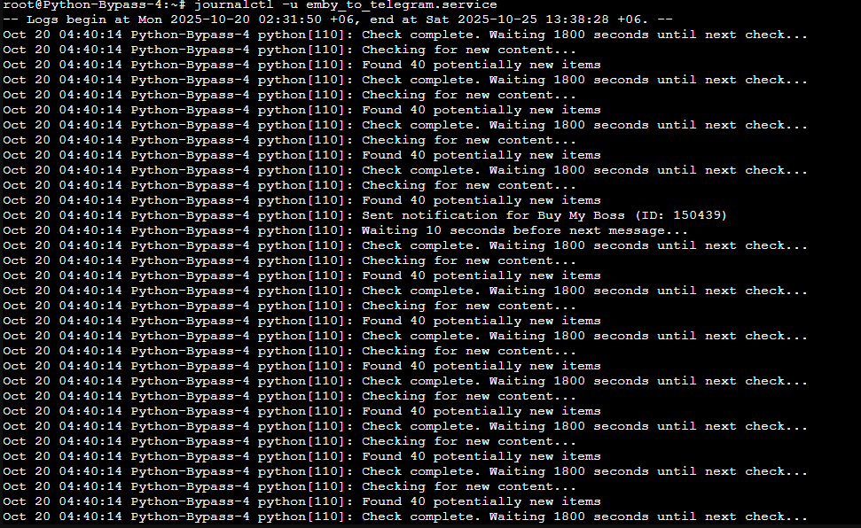

<div align="center">

# 🎬 Emby to Telegram Notifier

An automated, lightweight background service for **Ubuntu / Linux** that monitors your **Emby Media Server** and broadcasts sleek, media-rich notifications to your **Telegram** channel, group, or private chat.

[](https://www.python.org/)
[](https://ubuntu.com/)
[](https://core.telegram.org/bots)
[](LICENSE)

</div>

---

## ✨ Features

- 🔄 **Autonomous Background Service**: Runs silently 24/7 as a native `systemd` service on Ubuntu with automatic restarts on reboot or failure.
- 🎬 **Multi-Media Detection**: Watches for newly added **Movies** and **TV Series**.
- 📊 **Rich Metadata Cards**:
  - 📌 Title and release year
  - ⭐ Community Rating (`8.3/10`) & 🍅 Critic Rating (`73%`)
  - 🎭 Genres (e.g. *Action, Crime, Drama*)
  - ⏱️ Converted human-readable runtime (`1h 48m`)
  - 🔞 Age / content certification (`PG-13`, `R`, `TV-MA`)
  - 🎞️ Quality & file size (`1080p | 1.03 GB`)
  - 📺 TV Series status (*Continuing / Ended*)
- 🟢 **Styled Interactive Buttons**: One-click **`[Watch on SN FTP SERVER]`** inline button linking directly to the Emby web player with native Telegram Bot API color styling.
- 🖼️ **High-Res Poster Art**: Downloads and attaches primary poster artwork with automatic fallback to text if an image is missing.
- 🛡️ **Zero Duplicate Spam**: Tracks announced media IDs to guarantee notifications are sent only once.
- 🔐 **Safe Configuration**: Clean `.env` file separation keeps secrets out of code and version control.

---

## 📸 Screenshots

| Example Notifications | |
|:---:|:---:|
|  |  |
|  |  |

---

## 📦 Requirements

* **Ubuntu Linux** (20.04 LTS, 22.04 LTS, 24.04 LTS, or Debian-based distributions)
* **Python 3.8+**
* An active **Emby Media Server** with an API key
* A **Telegram Bot Token** (from [@BotFather](https://t.me/BotFather))
* A destination **Telegram Chat ID** (Channel, Group, or User ID)

---

## 🚀 Ubuntu Installation Guide

Follow these step-by-step instructions to install and configure the notifier on an Ubuntu server:

### Step 1: Install System Dependencies

Update package lists and install Python, `pip`, virtual environment tools, and `git`:

```bash
sudo apt update && sudo apt install -y python3 python3-pip python3-venv git
```

---

### Step 2: Clone the Repository

Clone the project to your preferred location (recommended standard path: `/opt/emby-to-telegram`):

```bash
sudo git clone https://github.com/sohag1192/emby-to-telegram.git /opt/emby-to-telegram
cd /opt/emby-to-telegram
```

---

### Step 3: Set Up Python Virtual Environment

Create an isolated virtual environment and install the required Python libraries:

```bash
# Create virtual environment
python3 -m venv venv

# Activate virtual environment
source venv/bin/activate

# Install dependencies
pip install --upgrade pip
pip install -r requirements.txt

# Deactivate venv
deactivate
```

---

### Step 4: Configure Credentials (`.env`)

Copy the sample environment file to `.env`:

```bash
cp .env.example .env
nano .env
```

Fill in your actual server details and bot tokens:

```ini
# Telegram Bot Configuration
TELEGRAM_TOKEN=123456789:ABCdefGhIJKlmNoPQRsTUVwxyZ
TELEGRAM_CHAT_ID=-1001234567890

# Emby Server Configuration
EMBY_SERVER=http://192.168.1.100:8096
EMBY_API_KEY=your_emby_api_key_here

# Optional: Intervals in seconds (Default: 1800s = 30 min, 10s delay between alerts)
CHECK_INTERVAL=1800
MESSAGE_DELAY=10
```

> **Tip:** Press `Ctrl + O`, then `Enter` to save in nano, and `Ctrl + X` to exit.

---

### Step 5: Test Run (Optional)

Verify your configuration before running in the background:

```bash
/opt/emby-to-telegram/venv/bin/python emby_to_telegram.py
```

If everything is configured properly, you will see:
```text
Starting Emby to Telegram notifier...
Checking for new content...
```
Press `Ctrl + C` to stop the test run.

---

## ⚙️ Running in the Background on Ubuntu

There are two primary ways to keep the script running in the background:

### Method 1: Systemd Service (Recommended & Production-Ready)

Running as a `systemd` service ensures the bot starts automatically on server boot, restarts automatically if it crashes, and lets you inspect logs easily.

1. **Copy the service file to the systemd directory:**

```bash
sudo cp /opt/emby-to-telegram/emby_to_telegram.service /etc/systemd/system/
```

2. **Reload systemd daemon:**

```bash
sudo systemctl daemon-reload
```

3. **Enable and start the service:**

```bash
# Enable to start automatically on system boot
sudo systemctl enable emby_to_telegram.service

# Start the service immediately
sudo systemctl start emby_to_telegram.service
```

4. **Check status:**

```bash
sudo systemctl status emby_to_telegram.service
```

5. **View live real-time logs:**

```bash
journalctl -u emby_to_telegram.service -f
```

#### Managing the Service:

| Action | Command |
| :--- | :--- |
| **Check Status** | `sudo systemctl status emby_to_telegram` |
| **Start Service** | `sudo systemctl start emby_to_telegram` |
| **Stop Service** | `sudo systemctl stop emby_to_telegram` |
| **Restart Service** | `sudo systemctl restart emby_to_telegram` |
| **Disable Boot Autostart** | `sudo systemctl disable emby_to_telegram` |
| **View Live Logs** | `journalctl -u emby_to_telegram -f` |

---

### Method 2: Running with `nohup` (Simple Background Run)

If you do not want to use `systemd`, you can run the bot using `nohup`:

```bash
cd /opt/emby-to-telegram
nohup /opt/emby-to-telegram/venv/bin/python emby_to_telegram.py > notifier.log 2>&1 &
```

* **Check the live log:**
  ```bash
  tail -f notifier.log
  ```

* **Stop the process:**
  ```bash
  pkill -f emby_to_telegram.py
  ```

---

## 🛠️ Configuration Options

All settings can be configured via environment variables or inside the `.env` file:

| Variable | Description | Default |
| :--- | :--- | :--- |
| `TELEGRAM_TOKEN` | Bot API token from [@BotFather](https://t.me/BotFather) | *Required* |
| `TELEGRAM_CHAT_ID` | Telegram Channel/Group/User ID | *Required* |
| `EMBY_SERVER` | Base URL of your Emby server (e.g., `http://100.100.100.6:8096`) | *Required* |
| `EMBY_API_KEY` | Emby API Key (*Emby Dashboard > Advanced > API Keys*) | *Required* |
| `CHECK_INTERVAL` | Interval between library checks (seconds) | `1800` (30 mins) |
| `MESSAGE_DELAY` | Delay between consecutive Telegram messages (seconds) | `10` |

---

## 🔄 Updating to Latest Version

To update your installation to the latest version:

```bash
cd /opt/emby-to-telegram
sudo systemctl stop emby_to_telegram.service
git pull
sudo systemctl start emby_to_telegram.service
```

---

## ❓ Troubleshooting

#### 1. `Telegram API Error: Bad Request: chat not found`
* Ensure your bot is added as an **Administrator** in your Telegram channel or group.
* If sending to a public channel, you can use `@YourChannelUsername`. For private channels, use the negative ID (e.g., `-100xxxxxxxxxx`).

#### 2. `Error fetching media from Emby: HTTPConnectionPool...`
* Check if your Emby server URL is reachable from the Ubuntu machine:
  ```bash
  curl -I http://YOUR_EMBY_IP:8096/emby/System/Info/Public
  ```
* Verify your Emby API key is valid in the Emby Admin Dashboard.

#### 3. Service fails to start (`Exit code 1`)
* Inspect recent error logs:
  ```bash
  journalctl -u emby_to_telegram.service -n 50 --no-pager
  ```
* Verify file permissions:
  ```bash
  sudo chown -R root:root /opt/emby-to-telegram
  ```

---

## 📊 Star History & Visitors

### ⭐ Star History
[](https://www.star-history.com/#sohag1192/emby-to-telegram&Date)

### 👀 Visitor Counter


---

## 📜 License

This project is licensed under the MIT License.
