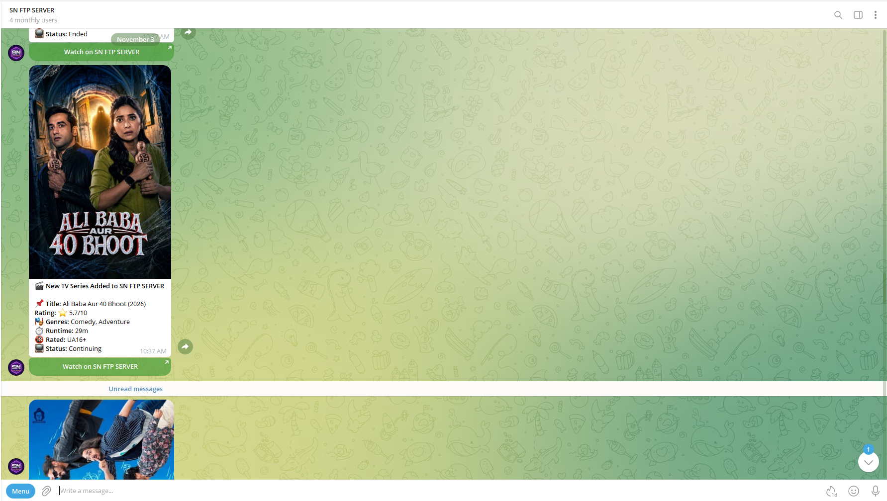
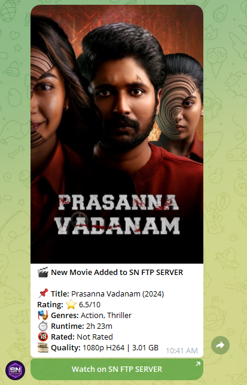
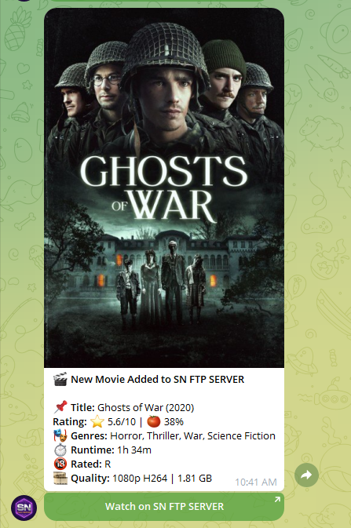

<div align="center">

# 🎬 এমবি টু টেলিগ্রাম নোটিফায়ার (Emby to Telegram Notifier)

**উইন্ডোজ এবং উবুন্টু / লিনাক্স (Windows & Ubuntu / Linux)**-এর জন্য একটি স্বয়ংক্রিয় ও লাইটওয়েট ব্যাকগ্রাউন্ড সার্ভিস, যা আপনার **এমবি মিডিয়া সার্ভার (Emby Media Server)** প্রতিনিয়ত পর্যবেক্ষণ করে এবং নতুন যুক্ত হওয়া মুভি ও টিভি সিরিজের আকর্ষণীয় পোস্টার ও বিস্তারিত তথ্যসহ সরাসরি আপনার **টেলিগ্রাম** চ্যানেল, গ্রুপ বা চ্যাটে নোটিফিকেশন পাঠায়।

[](https://github.com/sohag1192/emby-to-telegram/releases)
[](https://www.microsoft.com/windows)
[](https://ubuntu.com/)
[](https://www.python.org/)
[](https://core.telegram.org/bots)
[](LICENSE)
[](https://hits.sh/github.com/sohag1192/emby-to-telegram/)
[](https://github.com/sohag1192/emby-to-telegram/stargazers)

<br/>

**Language / ভাষা:**
[](README.md)
[](README_bn.md)

<p align="center">
  <a href="README.md">🇬🇧 <b>English</b></a> • 
  <a href="README_bn.md">🇧🇩 <b>বাংলা (Bengali)</b></a>
</p>

<br/>



</div>

---

## 📸 টেলিগ্রাম নোটিফিকেশন প্রিভিউ

<div align="center">

| 🎬 মুভি নোটিফিকেশন কার্ড | 📺 টিভি সিরিজ নোটিফিকেশন কার্ড |
| :---: | :---: |
|  |  |

</div>

---

## ✨ মূল বৈশিষ্ট্যসমূহ (Features)

- 🔄 **২৪/৭ নিরবচ্ছিন্ন ব্যাকগ্রাউন্ড সার্ভিস**: উবুন্টু/লিনাক্সে নেটিভ `systemd` সার্ভিস হিসেবে চলে। সার্ভার রিস্টার্ট বা ক্র্যাশ করলেও স্বয়ংক্রিয়ভাবে পুনরায় চালু হয়।
- 🛡️ **ডুপ্লিকেট প্রতিরোধে ডাবল-লক প্রোটেকশন**: এমবি আইটেম আইডি এবং টাইটেল-ইয়ার উভয়ের মাধ্যমেই চেক করা হয় (`emby_notified.txt`), ফলে কোনো কনটেন্টের নোটিফিকেশন কখনোই দুইবার যাবে না।
- 🎬 **মাল্টি-মিডিয়া মনিটরিং**: নতুন যুক্ত হওয়া **মুভি (Movies)** এবং **টিভি সিরিজ (TV Series)** স্বয়ংক্রিয়ভাবে শনাক্ত করে।
- 📊 **বিস্তারিত মেটাডাটা ইনফরমেশন**:
  - 📌 টাইটেল ও রিলিজ ইয়ার
  - ⭐ কমিউনিটি রেটিং (`8.3/10`) এবং 🍅 রটেন টমেটোজ রেটিং (`73%`)
  - 🎭 জনরা বা ধরন (যেমন: *অ্যাকশন, ড্রামা, ক্রাইম*)
  - ⏱️ মোট রানটাইম বা সময়সীমা (`1h 48m`)
  - 🔞 সেন্সর ও কন্টেন্ট সার্টিফিকেট (`PG-13`, `R`, `TV-MA`)
  - 🎞️ ভিডিও কোয়ালিটি ও ফাইল সাইজ (`1080p | 1.03 GB`)
  - 📺 টিভি সিরিজ স্ট্যাটাস (*Continuing / Ended*)
- 🟢 **ইন্টারেক্টিভ ওয়াচ বাটন**: সরাসরি এমবি প্লেয়ারে নিয়ে যাওয়ার জন্য আকর্ষণীয় সবুজ **`[SN FTP SERVER-এ দেখুন]`** বাটন।
- 🖼️ **হাই-রেজ্যুলেশন পোস্টার আর্ট**: সরাসরি অরিজিনাল পোস্টার ইমেজ ডাউনলোড করে পাঠায় (ইমেজ না থাকলে স্বয়ংক্রিয় টেক্সট ফলব্যাক)।
- ⚡ **লাইটওয়েট ও সুপার ফাস্ট**: অত্যন্ত কম সিপিইউ ও র‍্যাম মেমোরি ব্যবহার করে।

---

## 🚀 নতুন ভার্সন ৩.০ আপডেট (What's New in v3.0)

- 🪟 **উইন্ডোজের জন্য ডেডিকেটেড প্যাকেজ (`windows/`)**:
  - `install.bat`: ১-ক্লিক ইনস্টলার এবং স্বয়ংক্রিয়ভাবে উইন্ডোজ বুটে চালু হওয়ার সুবিধা।
  - `run.bat`: অলওয়েজ-রান কনসোল স্ক্রিপ্ট, যা ক্র্যাশ করলেও ১০ সেকেন্ড পর অটো-রিস্টার্ট হয়।
  - `run_background.bat` ও `run_hidden.vbs`: কোনো উইন্ডো ছাড়া ২৪/৭ নীরবে ব্যাকগ্রাউন্ডে চলার সুবিধা।
  - `status.bat` ও `stop.bat`: প্রসেস স্ট্যাটাস চেক ও ১-ক্লিকে সার্ভিস বন্ধ করার স্ক্রিপ্ট।
- 🐧 **লিনাক্সের জন্য ডেডিকেটেড প্যাকেজ (`linux/`)**:
  - `install.sh`: ১-ক্লিক ইনস্টলার ও নেটিভ systemd ব্যাকগ্রাউন্ড সার্ভিস।
  - ম্যানেজমেন্ট স্ক্রিপ্টসমূহ: `status.sh`, `logs.sh`, `restart.sh`, `stop.sh`, `uninstall.sh`।
- 🇧🇩 **স্বতন্ত্র বাংলা নোটিফায়ার ইঞ্জিন (`emby_to_telegram_bn.py`)**:
  - খাঁটি বাংলা ভাষায় আকর্ষণীয় নোটিফিকেশন কার্ড, ফরম্যাটেড রানটাইম ও রেটিং।
- 🛡️ **ডাবল-লক প্রোটেকশন ও টেক্সট ফলব্যাক**:
  - কোনো কনটেন্ট কখনোই দুইবার যাবে না এবং ইমেজ না পেলে স্বয়ংক্রিয় টেক্সট নোটিফিকেশন যাবে।
- 🧹 **পরিচ্ছন্ন প্রজেক্ট স্ট্রাকচার**:
  - প্রতিটি ওএস অনুযায়ী সুন্দর ফোল্ডার বিন্যাস এবং অপ্রয়োজনীয় ক্যাশ(`.gitignore`)-এ যুক্ত।
- 🚀 **আপগ্রেডেড গিটহাব আপলোড টুল (`upload_to_github.BAT`)**:
  - স্বয়ংক্রিয় Git Tag v3.0 পুশ, রিবেস হ্যান্ডলিং এবং রিলিজ ম্যানেজমেন্ট।

---

## 🔗 সম্পর্কিত অন্যান্য এমবি প্রজেক্টস

[@sohag1192](https://github.com/sohag1192)-এর তৈরি অন্যান্য জনপ্রিয় ওপেন-সোর্স প্রজেক্ট:

- 🎨 [**Emby Home Swiper UI**](https://github.com/sohag1192/Emby-Home-Swiper-UI) – এমবি ওয়েব ক্লায়েন্ট হোম স্ক্রিনের জন্য একটি আধুনিক ও আকর্ষণীয় টাচ-সাপোর্টেড ফুলস্ক্রিন সোয়াইপার ক্যারোসেল।
- 🔍 [**Emby Duplicate Finder**](https://github.com/sohag1192/emby-duplicate-finder) – এমবি লাইব্রেরির ডুপ্লিকেট মিডিয়া ফাইল সহজে খুঁজে বের করে ক্লিন ও অর্গানাইজ করার টুল।

---

## 📦 প্রয়োজনীয় রিকোয়ারমেন্টস

* **উবুন্টু / ডেবিয়ান লিনাক্স** অথবা **উইন্ডোজ (Windows 10 / 11 / Server)**
* **Python 3.8+**
* একটি সক্রিয় **Emby Media Server** এবং API Key
* একটি **Telegram Bot Token** ([@BotFather](https://t.me/BotFather) থেকে প্রাপ্ত)
* গন্তব্য **Telegram Chat ID** (চ্যানেল, গ্রুপ, বা পার্সোনাল আইডি)

---

## 🪟 ১-ক্লিক উইন্ডোজ সেটআপ ও অলওয়েজ-রান (Windows Setup)

উইন্ডোজের জন্য সমস্ত স্ক্রিপ্ট **`windows/`** ফোল্ডারে গুছিয়ে রাখা হয়েছে:

| স্ক্রিপ্ট ফাইল | অবস্থান | কাজ ও সুবিধা |
| :--- | :--- | :--- |
| **`install.bat`** | `windows/install.bat` | 🎬 **১-ক্লিক ইনস্টলার**: পাইথন ও ডিপেন্ডেন্সি ইনস্টল করে এবং উইন্ডোজ বুটে অটো-স্টার্ট কনফিগার করে। |
| **`run.bat`** | `windows/run.bat` | 🔄 **অলওয়েজ-রান মোড**: লাইভ লগ দেখতে পারবেন এবং ক্র্যাশ করলে ১০ সেকেন্ডে স্বয়ংক্রিয়ভাবে রিস্টার্ট হবে। |
| **`run_background.bat`** | `windows/run_background.bat` | 🚀 **ব্যাকগ্রাউন্ড মোড**: কোনো CMD উইন্ডো খোলা ছাড়াই ২৪/৭ নীরবে ব্যাকগ্রাউন্ডে চলবে। |
| **`status.bat`** | `windows/status.bat` | 📊 **স্ট্যাটাস চেক**: নোটিফায়ার বর্তমানে চলছে কি না তা এক ক্লিকে চেক করুন। |
| **`stop.bat`** | `windows/stop.bat` | 🛑 **সার্ভিস স্টপ**: চলমান নোটিফায়ার সার্ভিস সম্পূর্ণভাবে বন্ধ করতে। |

### ব্যবহারের নিয়ম:
1. **`windows/install.bat`** ফাইলে ডাবল-ক্লিক করুন। এটি স্বয়ংক্রিয়ভাবে `venv` তৈরি ও প্যাকেজ ইনস্টল করবে।
2. প্রম্পটে `Y` চাপলে এটি উইন্ডোজ স্টার্টআপ ফোল্ডারে যুক্ত হবে, ফলে কম্পিউটার অন করলেই স্বয়ংক্রিয়ভাবে ব্যাকগ্রাউন্ডে চালু হয়ে যাবে।
3. সরাসরি লাইভ কনসোলে দেখতে চাইলে **`windows/run.bat`** চালান, অথবা উইন্ডো ছাড়াই ব্যাকগ্রাউন্ডে চালাতে **`windows/run_background.bat`** চালান।

---

## ⚡ ১-ক্লিক দ্রুত ইনস্টলেশন (Ubuntu / Linux)

লিনাক্সের জন্য সমস্ত স্ক্রিপ্ট ও সার্ভিস ফাইল **`linux/`** ফোল্ডারে রাখা হয়েছে:

1. **রিপোজিটরি ক্লোন করুন:**
   ```bash
   sudo git clone https://github.com/sohag1192/emby-to-telegram.git /opt/emby-to-telegram
   cd /opt/emby-to-telegram
   ```

2. **`emby_to_telegram.py` ফাইলটিতে আপনার তথ্য যুক্ত করুন:**
   ```bash
   nano emby_to_telegram.py
   ```
   আপনার `TELEGRAM_TOKEN`, `TELEGRAM_CHAT_ID`, `EMBY_SERVER`, এবং `EMBY_API_KEY` সেট করুন।

3. **ইনস্টলার স্ক্রিপ্টটি চালান:**
   ```bash
   # বাংলা নোটিফিকেশনের জন্য:
   sudo bash linux/install.sh emby_to_telegram_bn.py

   # অথবা ইংরেজি নোটিফিকেশনের জন্য:
   sudo bash linux/install.sh emby_to_telegram.py
   ```

> 💡 **লিনাক্স সার্ভিস ম্যানেজমেন্ট স্ক্রিপ্টসমূহ (`linux/` ফোল্ডারে):**
> - **স্ট্যাটাস দেখতে:** `sudo bash linux/status.sh`
> - **লাইভ লগ দেখতে:** `sudo bash linux/logs.sh`
> - **রিস্টার্ট করতে:** `sudo bash linux/restart.sh`
> - **সার্ভিস বন্ধ করতে:** `sudo bash linux/stop.sh`
> - **আনইনস্টল করতে:** `sudo bash linux/uninstall.sh`

> **`install.sh` স্বয়ংক্রিয়ভাবে যা যা করে:**
> - পাইথন, venv এবং সিস্টেম প্যাকেজগুলো ইনস্টল করে।
> - ভার্চুয়াল এনভায়রনমেন্ট তৈরি করে প্রয়োজনীয় লাইব্রেরি ইনস্টল করে।
> - `emby-to-telegram.service` তৈরি করে systemd-তে রেজিস্টার করে।
> - সার্ভার বুট হওয়ার সাথে সাথে অটো-স্টার্ট চালু করে এবং সাথে সাথেই ব্যাকগ্রাউন্ডে সার্ভিসটি রান করে দেয়।

---

## 📖 ম্যানুয়াল ইনস্টলেশন গাইড (Ubuntu Linux)

আপনি যদি নিজে ধাপে ধাপে সব কনফিগার করতে চান:

### ধাপ ১: সিস্টেম প্যাকেজ ইনস্টল করুন
```bash
sudo apt update && sudo apt install -y python3 python3-pip python3-venv git
```

### ধাপ ২: ক্লোন এবং ভার্চুয়াল এনভায়রনমেন্ট সেটআপ
```bash
sudo git clone https://github.com/sohag1192/emby-to-telegram.git /opt/emby-to-telegram
cd /opt/emby-to-telegram

python3 -m venv venv
source venv/bin/activate
pip install -r requirements.txt
deactivate
```

### ধাপ ৩: ব্যাকগ্রাউন্ড সিস্টেমড (Systemd) সার্ভিস চালু করুন
```bash
# সার্ভিস ফাইল কপি করুন
sudo cp /opt/emby-to-telegram/emby_to_telegram.service /etc/systemd/system/

# সার্ভিস রিলোড এবং স্টার্ট করুন
sudo systemctl daemon-reload
sudo systemctl enable --now emby_to_telegram.service

# স্ট্যাটাস চেক করুন
sudo systemctl status emby_to_telegram.service

# লাইভ রিয়েল-টাইম লগ দেখুন
journalctl -u emby_to_telegram.service -f
```

#### প্রয়োজনীয় লিনাক্স সার্ভিস কমান্ড:
| কাজ | কমান্ড |
| :--- | :--- |
| **স্ট্যাটাস দেখা** | `sudo systemctl status emby_to_telegram` |
| **সার্ভিস শুরু করা** | `sudo systemctl start emby_to_telegram` |
| **সার্ভিস বন্ধ করা** | `sudo systemctl stop emby_to_telegram` |
| **সার্ভিস রিস্টার্ট করা** | `sudo systemctl restart emby_to_telegram` |
| **লাইভ লগ দেখা** | `journalctl -u emby_to_telegram -f` |

---

## 🛠️ কনফিগারেশন বিবরণী

`emby_to_telegram.py` ফাইলের ভেতরে (অথবা এনভায়রনমেন্ট ভেরিয়েবলের মাধ্যমে):

| প্যারামিটার | বিবরণ | ডিফল্ট মান |
| :--- | :--- | :--- |
| `TELEGRAM_TOKEN` | [@BotFather](https://t.me/BotFather) থেকে প্রাপ্ত টেলিগ্রাম বট টোকেন | *প্রয়োজনীয় (Required)* |
| `TELEGRAM_CHAT_ID` | টেলিগ্রাম চ্যানেল, গ্রুপ বা ইউজার আইডি | *প্রয়োজনীয় (Required)* |
| `EMBY_SERVER` | এমবি সার্ভারের অ্যাড্রেস (যেমন: `http://100.100.100.6:8096`) | *প্রয়োজনীয় (Required)* |
| `EMBY_API_KEY` | এমবি এপিআই কি (*ড্যাশবোর্ড > অ্যাডভান্সড > এপিআই কি*) | *প্রয়োজনীয় (Required)* |
| `CHECK_INTERVAL` | লাইব্রেরি চেক করার বিরতি (সেকেন্ডে) | `1800` (৩০ মিনিট) |
| `MESSAGE_DELAY` | প্রতি মেসেজের মাঝে বিরতি (সেকেন্ডে) | `10` |

---

## 🔄 নতুন সংস্করণে আপডেট করার নিয়ম

```bash
cd /opt/emby-to-telegram
sudo systemctl stop emby_to_telegram.service
git pull
sudo systemctl start emby_to_telegram.service
```

---

## ❓ সম্ভাব্য সমস্যা ও সমাধান (Troubleshooting)

#### ১. `Telegram API Error: Bad Request: chat not found`
* বটটি আপনার টেলিগ্রাম চ্যানেল বা গ্রুপে **Administrator** হিসেবে যুক্ত আছে কিনা নিশ্চিত করুন।
* পাবলিক চ্যানেল হলে `@YourChannelUsername` ব্যবহার করুন। প্রাইভেট চ্যানেলের ক্ষেত্রে মাইনাসসহ নিউমেরিক আইডি দিন (যেমন: `-100xxxxxxxxxx`)।

#### ২. `Error fetching media from Emby: HTTPConnectionPool...`
* আপনার মেশিন থেকে এমবি সার্ভারে কানেকশন পৌঁছাচ্ছে কিনা চেক করুন:
  ```bash
  curl -I http://YOUR_EMBY_IP:8096/emby/System/Info/Public
  ```
* এমবি অ্যাডমিন ড্যাশবোর্ড থেকে এপিআই কি সঠিক আছে কিনা যাচাই করুন।

#### ৩. সার্ভিস চালু হতে ব্যর্থ হলে (`Exit code 1`)
* সাম্প্রতিক এরর লগ চেক করুন:
  ```bash
  journalctl -u emby_to_telegram.service -n 50 --no-pager
  ```

---

## 📊 স্টার হিস্ট্রি ও ভিজিটর কাউন্টার

### 👀 দৈনিক ও সর্বমোট হিট (Daily & Total Hits)
[](https://hits.sh/github.com/sohag1192/emby-to-telegram/)

### ⭐ স্টার হিস্ট্রি
[](https://www.star-history.com/#sohag1192/emby-to-telegram&Date)

---

## 📜 লাইসেন্স

এই প্রজেক্টটি MIT লাইসেন্সের অধীনে উন্মুক্ত।
